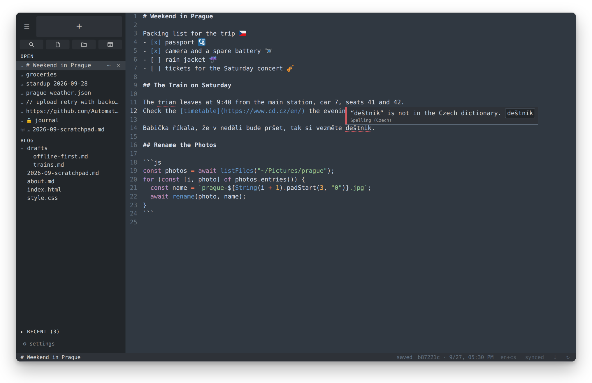
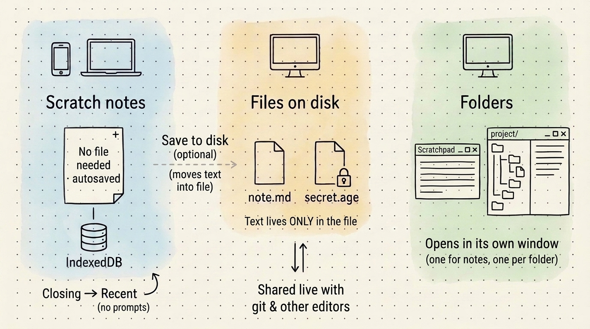
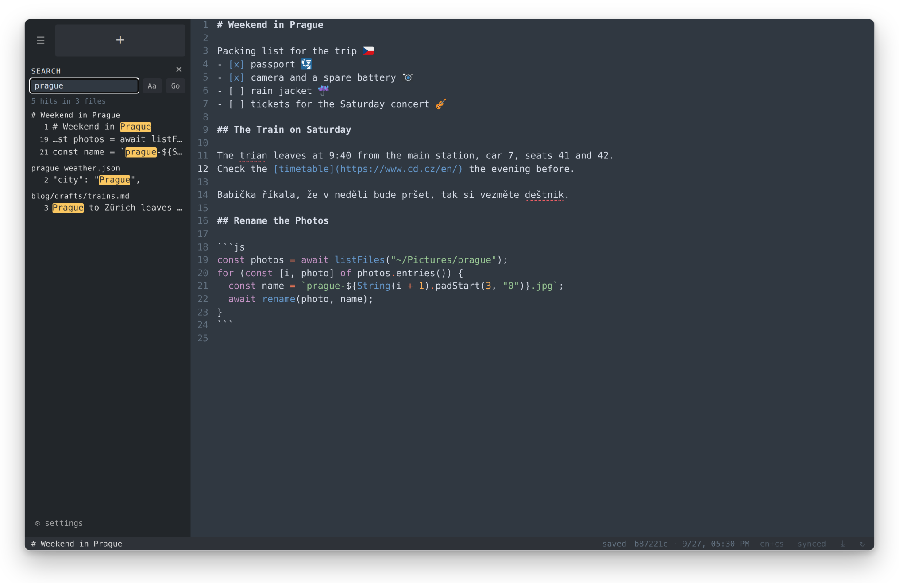
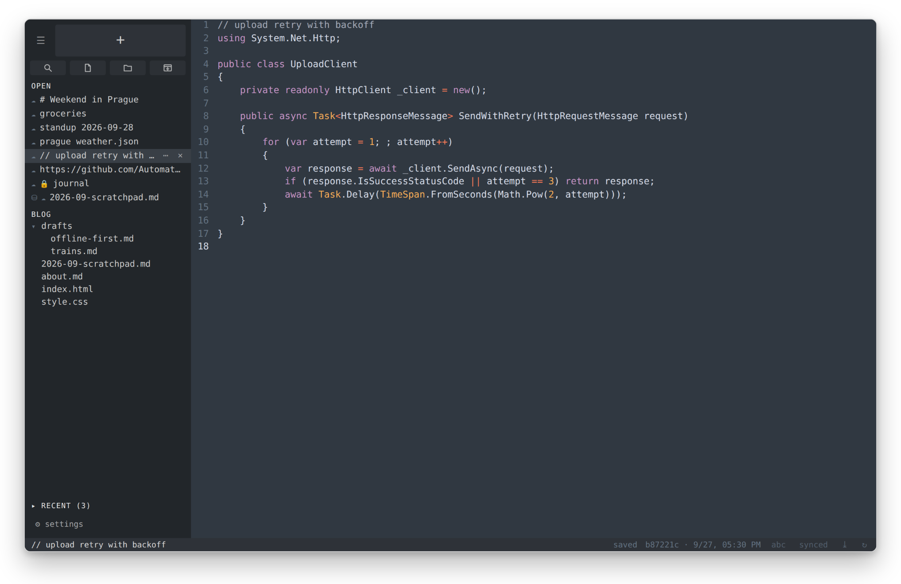
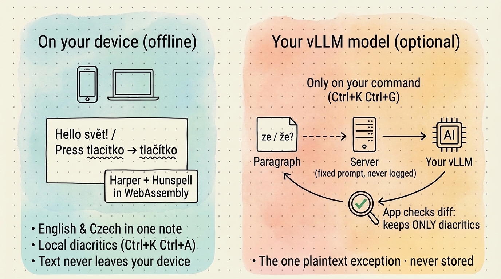
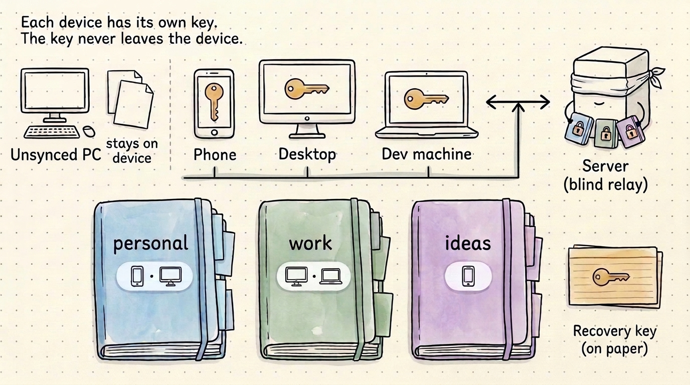
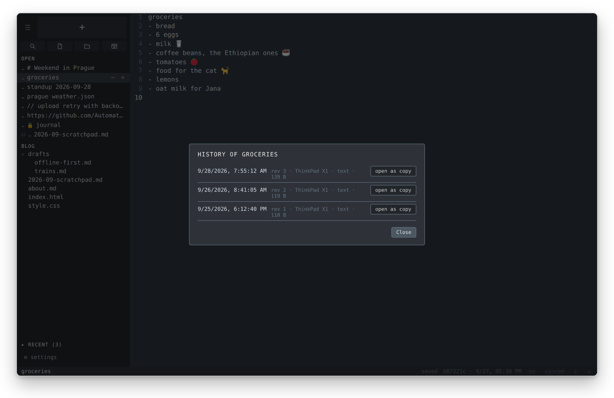
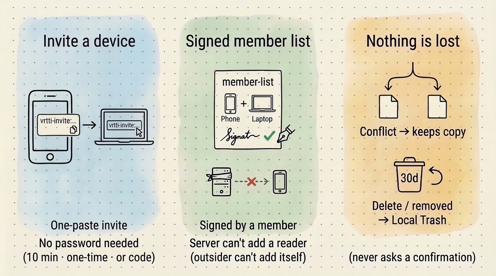
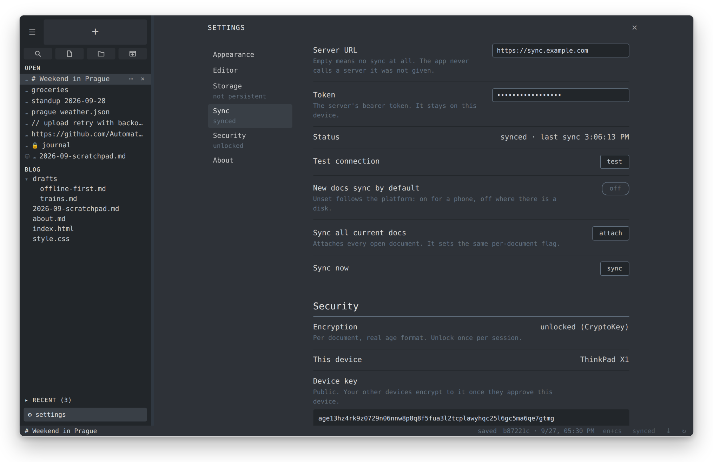
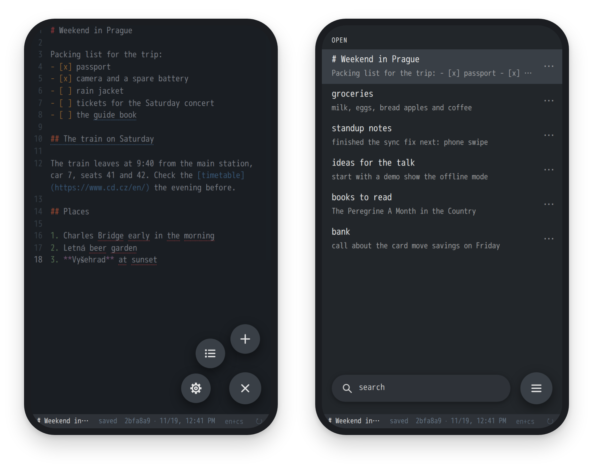

<p align="center">
  
</p>

<h1 align="center">vrtti</h1>

<p align="center">
  A scratchpad/note text editor in the spirit of Sublime Text.<br>
  Your notes survive a restart without a save, and closing a note never asks a question.<br>
  It runs in the browser, as an installed app on a desktop or a phone, and in a small desktop shell.<br>
  It has optional sync across devices and strong encryption.
</p>

<p align="center">
  <a href="https://urza.github.io/editor/"><b>Open vrtti</b></a>
  &nbsp;·&nbsp;
  <a href="https://github.com/urza/editor/releases/tag/desktop-latest">Desktop builds</a>
  &nbsp;·&nbsp;
  <a href="server/README.md">Sync server</a>
  &nbsp;·&nbsp;
  <a href="https://urza.github.io/editor/docs/how-it-works.html">How it works</a>
  &nbsp;·&nbsp;
  <a href="https://urza.github.io/editor/docs/trust-model.html">Trust model</a>
</p>



## Why

Sublime Text makes a good scratchpad. You open a new tab, type, and the text is
still there after a reboot, with no file name and no save. vrtti keeps that
habit and removes what got in the way:

- Closing twenty unsaved tabs meant twenty confirmations. In vrtti a closed note goes to Recent.
- The sidebar text could not be made larger. vrtti sizes the interface and the editor text separately.
- Spellcheck for English and Czech was hard to set up. vrtti has both built in.
- Private notes had no encryption, and the notes did not reach the phone. vrtti has optional encryption and optional sync to your own server.

## Features

### Notes that need no file

- Press `+` (or Alt+N) and type. The first line is the title until you rename the note.
- Each note is saved to the browser's IndexedDB 300 ms after you stop typing. A crash or a reboot loses nothing.
- Closing a note never asks. The note moves to **Recent** and stays there with no time limit, and one click opens it again. Which notes are open vs. in Recent is local to each window and never syncs.
- A note you leave empty is dropped, so the sidebar does not fill with blank tabs.

### Files and folders

- Open a single file or a whole folder. A folder shows as a tree in the sidebar (or in its own window in the desktop app), and its files open next to your notes.
- Saving a scratch note to disk is optional. Once you save it to disk, the file holds the only copy of the text, and vrtti is one of its editors.
- A change made by another program appears when the window gets focus. If you also have unsaved text, vrtti keeps it in a separate note.
- In the desktop app you can drop a file on the window, or use the system's "Open with" menu.

Files and folders need Chrome or Edge on a desktop (File System Access API), or the desktop app. Firefox and phones get everything else.



### Find in files

Ctrl+Shift+F searches the notes and the folders of the current window. Click a hit to jump to the line.



### Syntax highlighting

Markdown (with colored fenced code blocks), JavaScript, TypeScript, JSX, TSX,
HTML, CSS, JSON and C#. A file gets its mode from the extension. A scratch note
gets it from the content when you paste: paste JSON into an empty note and the
note turns into JSON. The color scheme follows Sublime's Mariana.



### Multiple cursors

The Sublime keys work in the editor. Ctrl+D selects the next occurrence of
the word, Alt+F3 selects all of them, Ctrl+Shift+L gives a selection one
cursor per line, and Ctrl+Alt+Up or Down adds a cursor on the next line.
Ctrl+click adds a cursor where you click. A drag with the middle button, or
with Alt held, selects a column. Escape goes back to one cursor. On a Mac
the keys are Sublime's Mac keys: Cmd+D, Ctrl+Cmd+G, Cmd+Shift+L,
Ctrl+Shift+Up and Down, and Cmd+click.

### Spellcheck in English and Czech

English runs on [Harper](https://github.com/Automattic/harper), Czech on
Hunspell with a Czech dictionary. Both run in the page as WebAssembly, so the
check works offline and your text stays on the device. You can mix the two
languages freely, also in one sentence: a word gets a mark only when each
language of the note rejects it. The buttons **cs** and **en** in the status
bar switch a language off or on for the open note, and the choice syncs with
the note. On a phone the same switches are in Settings.

A typo gets a red mark. Czech written without diacritics gets a blue mark, and
its suggestions are the Czech words with the same letters plus diacritics
("tlacitko" gives "tlačítko"). Hover a marked word for suggestions, press
Ctrl+. for them as a menu, or tap the word on a phone, and pick one to apply it.

**Add diacritics.** Two commands put the diacritics into the selection, or
into the whole note when nothing is selected. Each one is a single undo step.

- **Add diacritics (local)**, Ctrl+K Ctrl+A, changes each word that has
  exactly one fitting Czech word. A word with more than one ("palcove" can be
  "palcové" or "palcově") keeps its blue mark. The text stays on the device.
- **Add diacritics (vllm)**, Ctrl+K Ctrl+G, does the same, then asks your own
  language model for the other words, for example "ze" or "že". It shows only
  when your sync server has a model (`VRTTI_MODEL_URL`, see
  [server/README.md](server/README.md)). The paragraphs with such words go to
  the sync server and from there to the model, also from an encrypted note,
  and only when you start the command. vrtti keeps a change of the model only
  when it adds diacritics and the result is a Czech word. In an English
  paragraph it changes only words with a blue mark. Short Czech words such as
  "az" or "tim" look English to the checker; the setting **Model may fix
  English-looking words in Czech paragraphs** (Settings › Editor, on by
  default) lets the model write "až" and "tím" in a Czech paragraph.

The menu of a note (**⋯**) has the two commands too, for the whole note.



### Emoji

Emoji draw as [Twemoji](https://github.com/jdecked/twemoji) graphics, so they
look the same on every system. The graphics ship with the app and work offline.
The text in the note keeps the normal emoji characters.

### Sync to your own server (optional)



- The server is small: an ASP.NET Core API with one SQLite file, acting as a blind relay. A Docker image is ready (see [server/README.md](server/README.md)).
- You choose per note what syncs, from the note's menu. Settings can turn sync on for every open note at once. **New notes** (Settings › Sync) sends every new note of a device to one space, or keeps it local. A device with no disk, such as a phone, explains that a space keeps a copy of its notes, but it never picks one for you. A note that does not sync sits in no space and stays on its device.
- A synced note lives in one **space**. Think of a space as a colored notebook (`personal`, `work`, `ideas`) whose cover lists the devices that can open it: one note belongs to one space, while a device can belong to many spaces, one, or none. **Settings › Devices** shows a grid of devices and spaces; tick a box to add a device, untick it to remove one. A dev machine in `work` never gets a note of `personal`, not even a title.
- **Move to <space>** in a note's menu moves one note to another space and re-encrypts it for that space's members. A device that loses a note (a move away, or its removal from a space) keeps its copy in the local trash.
- Each row shows its space as a thin colored bar. Each device takes a space as tabs, or as titles only under **From server** (a click fetches the note).
- Every push is a revision. **History** lists them, and any revision opens as a copy next to the current text.
- When two devices edit the same note, the newer server version wins, and your local text stays as a separate note. Nothing prompts and nothing is lost.
- When the server says a note was deleted, the note goes to a local trash for 30 days first. **Settings › Storage › Deleted notes** restores it. A wrong or forged delete from the server cannot wipe a note.
- **Back up to a folder** (Settings › Sync) writes each note of a space into a folder, as plain text or as `.age` files.



### Encryption

- Each synced note is encrypted for the devices of its space and for your recovery key. The format is standard [age](https://age-encryption.org), through [typage](https://github.com/FiloSottile/typage). The server refuses plain text and holds no readable title.
- Each device has its own key, and the key never leaves the device. By default the device keeps it in the browser, where no script can copy it, and asks nothing at start. **Ask for a passphrase at start** (Settings › Devices) is for a notebook that can get stolen.
- The first device shows a recovery key one time. Keep it offline, on paper or in a password manager. It opens every note if all devices are lost.
- A new device joins with an invite: **Invite a device** on a device you use shows it, and the new device pastes it in Settings › Sync. The invite holds the server URL, a one-time code, the spaces, and whether each space opens its notes as tabs or as titles only. The URL and the code also work typed by hand. An invite can give no space: the device then joins the server only, and any device adds it to spaces later in Settings › Devices. The server cannot add a reader: the member list of a space is a log of entries that your devices sign, and your devices find each other through introductions that they sign. [The trust model](https://urza.github.io/editor/docs/trust-model.html) explains the signatures.
- A file on disk can become `name.md.age` (or `name.age`), and the `age` command line tool can decrypt it. A synced note saved to disk always saves as `.age`. The app is never the only way to read your notes.
- **Lock with PIN** in a note's menu keeps a note off the screen until the 4-digit PIN of the device. It is a guard for the screen, not encryption.





### Phone

Open the site in Safari or Chrome and add it to the home screen. The app works
with one thumb there. The round button at the bottom right shows three more
buttons: a new note, the note list, and the settings. The note list fills the
screen, and each row shows the start of the note and the date of its last
change. The note you changed last is at the bottom, next to the round button.
A swipe to the left on a row closes that note. The note goes to Recent, and a
tap there opens it again. Start the swipe on the row and not at the screen
edge, because Android takes a swipe from the edge as Back. On Android, Back closes the top open part (a menu, the
round buttons, the settings, or the list). A phone shows no status bar.
**Settings › Update** shows the build and looks for a newer one.

The notes are the same as on the desktop once sync is on. Phones cannot open
folders, so sync is also the backup there.

<p align="center">
  
</p>

### Windows

Each window has its own open notes and folders, like a Sublime window. In a
browser a new window opens as a tab. In the desktop app it is a real window.

The first window is the scratchpad. It comes back at every launch, and in the
desktop app it never holds a folder: open a folder there and the folder gets a
window of its own. Every other window is a session, and its title says so.
Close a session window and its notes and files go to Recent, where you can
open them again. Quit with windows open and they all come back.

## Get it

**In the browser.** Open <https://urza.github.io/editor/>. To install it as an
app, use the install button in the address bar (Chrome, Edge) or "Add to Home
Screen" (Safari on iOS). The app works offline after the first visit.

**Desktop app.** Browsers keep Ctrl+N and Ctrl+W for themselves, so no web page
can use them. The desktop app is a [Tauri](https://tauri.app) window around the
same page, and it gives these keys back. Downloads are on the
[desktop-latest](https://github.com/urza/editor/releases/tag/desktop-latest) release:

| System  | File |
| ------- | ---- |
| Windows | `vrtti-setup.exe` |
| macOS   | `vrtti-macos-universal.dmg` |
| Linux   | `vrtti-linux-x86_64.AppImage` or `vrtti-linux-x86_64.deb` |

The builds are not signed, so Windows and macOS show a warning at the first
launch. The app updates itself. The page comes from GitHub Pages, and the
shell checks a signed update manifest.

**Sync server.** Generate a token, then run the image:

```sh
export VRTTI_TOKEN=$(openssl rand -hex 32); echo "$VRTTI_TOKEN"
docker run -d --name vrtti --restart unless-stopped \
  -p 8080:8080 -v vrtti-data:/data -e VRTTI_TOKEN \
  -e VRTTI_ORIGINS=https://urza.github.io \
  ghcr.io/urza/vrtti-server:latest
```

Put a reverse proxy with HTTPS in front of it. On your first device, use
**Settings › Sync › Sync with a server**, choose "First device", and type the
URL and the token. Every other device pastes an invite from **Invite a device**
on the first one. [server/README.md](server/README.md) lists the API and all
options.

**Upgrade from a version before spaces as groups of devices.** Old and new
devices do not work together; update all of them.

1. Make a new `VRTTI_TOKEN` and start the new server image with it. Your dev
   machines keep the old token, which the new server refuses.
2. On your phone, update the app and type your old passphrase one time. Then
   choose "First device on this server" and type the new token. The phone
   takes over the spaces that exist on the server, encrypts their notes and
   removes the readable old versions.
3. On the phone, use **Invite a device** for each other device, with its
   spaces. Each one joins with its invite.

What the server still sees: note ids, space names, sizes, times, which device
made each change, and the device names and member lists. A device that someone
takes over can change the spaces it is in; it cannot touch other spaces. A
removed device keeps what it downloaded before.

## Keyboard shortcuts

| Action         | Browser and installed app | Desktop app |
| -------------- | ------------------------- | ----------- |
| New note       | Alt+N                     | Ctrl+N      |
| Close note     | Alt+W                     | Ctrl+W      |
| Save           | automatic                 | Ctrl+S      |
| Save as        | palette: Save to disk     | Ctrl+Shift+S |
| New window     | Alt+Shift+N               | Ctrl+Shift+N |
| Close window   | close the tab             | Ctrl+Shift+W |
| Find in files  | Ctrl+Shift+F              | Ctrl+Shift+F |
| Toggle sidebar | Alt+B                     | Alt+B       |
| Zoom note      | Ctrl+wheel                | Ctrl+wheel  |
| Spelling fixes | Ctrl+.                    | Ctrl+.      |
| Add diacritics (local) | Ctrl+K Ctrl+A     | Ctrl+K Ctrl+A |
| Add diacritics (vllm)  | Ctrl+K Ctrl+G     | Ctrl+K Ctrl+G |

The Alt keys also work in the desktop app. On a Mac, Cmd takes the place of
Ctrl. In the desktop app, Ctrl+S writes a file note to disk at once, and asks
where to save a scratch note. Ctrl+wheel over a note zooms that note alone,
on top of the editor text size in Settings, until you close it. **View › Word
Wrap** in the desktop app's menu turns the folding of long lines off and on;
off, the note scrolls sideways. The choice is kept per device.

## How it is built

- **No build step.** Plain JavaScript modules and one import map. There is no Node and no npm. The libraries are copied into `app/vendor/` as published files, pinned and listed in [app/VENDOR.md](app/VENDOR.md).
- **Editor:** [CodeMirror 6](https://codemirror.net).
- **Storage:** IndexedDB for notes, the File System Access API for files, and a small Rust disk backend in the desktop app.
- **Offline:** a service worker caches the whole app.
- **Desktop:** Tauri 2. The shell loads the deployed page, so a push to `main` updates the desktop app too.
- **Server:** ASP.NET Core minimal API on .NET 10 with SQLite. It stores each note as opaque content and never looks inside. The one exception is "Add diacritics (vllm)": the paragraphs it sends pass through the server to your model, on your command only.

[architecture.md](architecture.md) records each design decision and the reason for it.

## Repository layout

```
app/            the web app, deployed to GitHub Pages as it is
src-tauri/      the desktop shell (Tauri, Rust)
server/         the sync server (ASP.NET Core, SQLite)
design/icons/   icon sources and the icons that were not picked
crypto-proto/   the age prototype that came before the real code
docs/           the "How it works" and trust model pages, README screenshots and diagrams (deployed to GitHub Pages under docs/)
```

## Run it locally

```sh
cd app
python3 -m http.server 8000
```

Then open <http://localhost:8000>. The modules do not load from `file://`.
The service worker serves cached files first, so after an edit use a reload
that bypasses the cache, or turn on "Update on reload" in the browser's
developer tools.

## Credits

- The idea and the Mariana colors come from [Sublime Text](https://www.sublimetext.com).
- [CodeMirror](https://codemirror.net) (MIT), [Harper](https://github.com/Automattic/harper) (Apache-2.0), Hunspell (MPL-1.1) with the [Czech dictionary](https://www.npmjs.com/package/dictionary-cs) (GPL-2.0), [typage](https://github.com/FiloSottile/typage) (BSD-3-Clause) and the noble and scure libraries (MIT). [app/VENDOR.md](app/VENDOR.md) has versions and sources.
- Graphics from [Twemoji](https://github.com/jdecked/twemoji). Copyright 2022-present Jason Sofonia & Justine De Caires. Copyright 2014-2021 Twitter, Inc and other contributors. Licensed under [CC-BY 4.0](https://creativecommons.org/licenses/by/4.0/).

The name is Sanskrit. *Vṛtti* means the movements of the mind, and also a
commentary written on a text.

## License

YOU CAN USE THIS SOFTWARE "AS IS" (NO WARRANTY) IN ANY WAY YOU WANT, BUT BY DOING SO YOU ACKNOWLEDGE THAT:

Science is a force for human liberation and one of humanity's greatest inventions. Through open inquiry, evidence, and the willingness to correct our errors, we expand our understanding and our ability to improve the human condition.

Technology is the physical manifestation of our discoveries. By building better tools, we overcome limitations, reduce suffering, and create abundance.

Free markets enable cooperation on an extraordinary scale. Through competition, exchange, and entrepreneurship, they reward useful ideas, spread innovation, and help lift people out of poverty.

